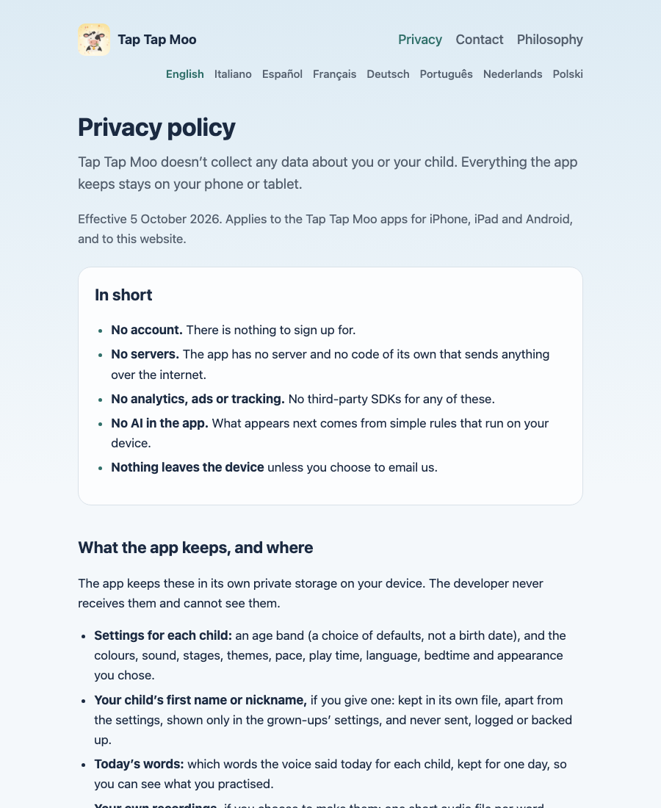
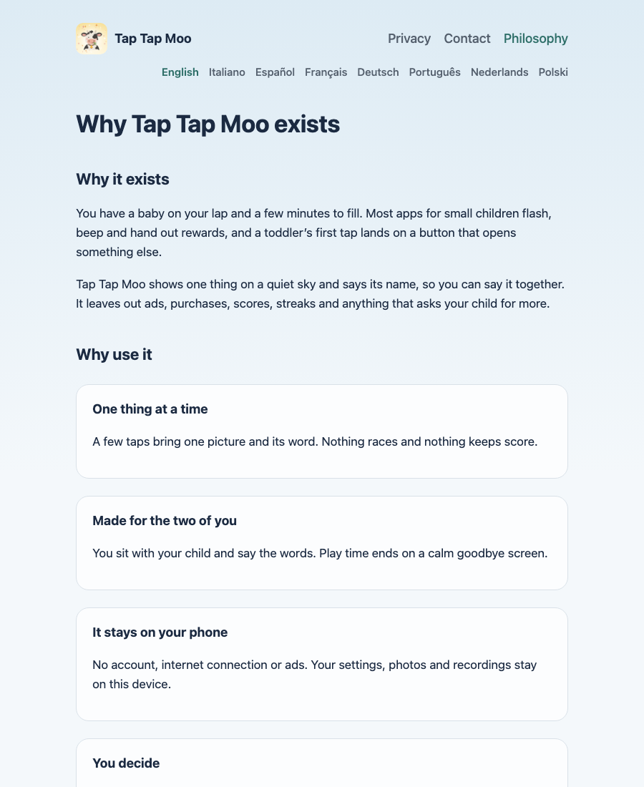
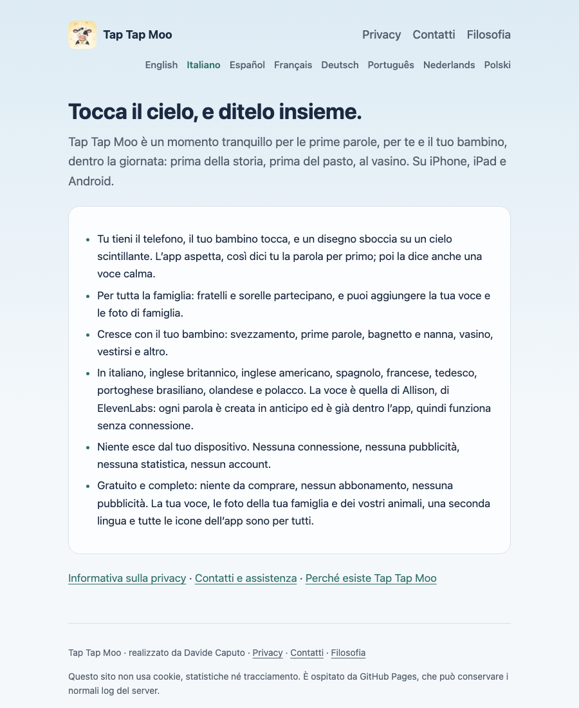
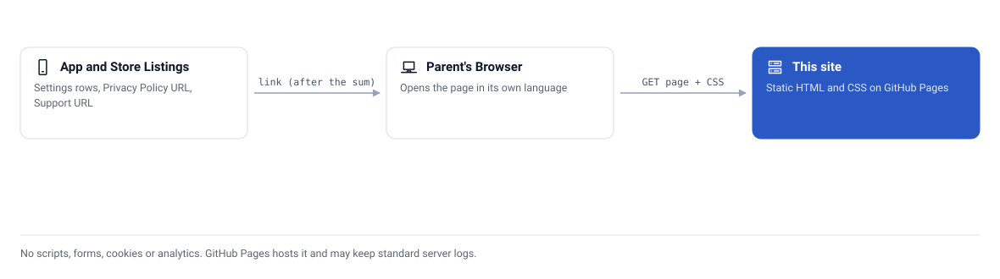

<div align="center">


# 🐄 Tap Tap Moo site

**Privacy policy, support and philosophy pages for the Tap Tap Moo first-words app, in every language the app speaks, with no scripts, cookies or trackers**


[](https://github.com/CaputoDavide93/tap-tap-moo-site/actions/workflows/ci.yml)

</div>

---

## ✨ Features

This repository is the public website for **Tap Tap Moo**, a calm first-words
game for babies and toddlers on iPhone, iPad and Android. App stores need a
privacy policy and a support page, and the app opens both from its Settings.
This site is where they live. Open it at
[caputodavide93.github.io/tap-tap-moo-site](https://caputodavide93.github.io/tap-tap-moo-site/).

### Why it exists

A parent handing a phone to a small child wants to know one thing before they
tap Install: what does this app keep, and who sees it? The answer has to be
on a page they can read in their own language, on their phone, without a
cookie banner. The stores want the same page as a link.

So the policy is a plain static page. It says what stays on the device, what
the microphone is for, that nothing is sold, and how to delete everything. The
same page exists in each language the app ships, and each page links to its
twin in every other language.

| | This site | A policy page on a generic site builder | A policy PDF |
|---|---|---|---|
| Scripts, cookies, analytics | None (a check fails the build if a script or form appears) | Often present | None |
| Readable on a phone | Yes, one column from 375 px | Depends on the theme | Pinch and zoom |
| Light and dark | Follows the reader's system setting | Depends on the theme | No |
| Same page in every app language | Yes, linked from each page | Usually one language | One file per language, hard to link |
| Stable URLs the stores can keep | `/privacy/`, `/contact/`, `/<lang>/privacy/` | Tied to the builder | Tied to a file name |
| Review the change before it goes live | Pull request, then GitHub Pages publishes `main` | Edit in a web editor | Replace the file |

The one trade-off: every language is a separate hand-written file, so a change
to the policy means editing all of them, and GitHub Pages may keep standard
server logs for visitors. Both are stated on the site.

### Install in 3 steps

There is nothing to install to read the site. To preview or edit it you need
Python 3 (any recent version) and a browser.

1. **Clone:** `git clone https://github.com/CaputoDavide93/tap-tap-moo-site.git && cd tap-tap-moo-site`
2. **Serve:** `make serve` (the same as `python3 -m http.server 8000`).
3. **Open** <http://localhost:8000/>. Run `make check` before you push.

### What you get

| | Page | What it is |
|---|---|---|
| 🏠 | [Home](https://caputodavide93.github.io/tap-tap-moo-site/) | What the app is, in a few lines |
| 🔒 | [Privacy policy](https://caputodavide93.github.io/tap-tap-moo-site/privacy/) | What the app keeps on the device, the voice, the microphone, payments (none: nothing is sold), children. Linked from the app's Settings and the store listings |
| ✉️ | [Contact](https://caputodavide93.github.io/tap-tap-moo-site/contact/) | Support address and common questions. Linked from the app's Settings and the store listings |
| 🌱 | [Philosophy](https://caputodavide93.github.io/tap-tap-moo-site/philosophy/) | Why the app exists, in the app's own words |
| 🌍 | Every language | English, Italian (`it/`), Spanish (`es/`), French (`fr/`), German (`de/`), Brazilian Portuguese (`pt/`), Dutch (`nl/`) and Polish (`pl/`). The app opens the privacy and contact pages in its own language |
| 🌗 | Light and dark | Follows the reader's system setting, in the app's own colours |
| 🚫 | No tracking | No scripts, forms, cookies or analytics, and a check that fails if one appears |
| 🧪 | Self-checking | `make check` verifies every page exists in every language, every local link resolves, and the support address is the only one |

---

## 📸 Screenshots

Taken from the served site by `make screenshots` (Chromium, 900 px wide). The
contact page is left out because it shows the support address.

<table>
<tr>
<td width="50%">
<picture>
  <source media="(prefers-color-scheme: dark)" srcset="docs/assets/screenshots/home-dark.png">
  
</picture>
</td>
<td width="50%">
<picture>
  <source media="(prefers-color-scheme: dark)" srcset="docs/assets/screenshots/privacy-dark.png">
  
</picture>
</td>
</tr>
<tr>
<td>
<picture>
  <source media="(prefers-color-scheme: dark)" srcset="docs/assets/screenshots/philosophy-dark.png">
  
</picture>
</td>
<td>
<picture>
  <source media="(prefers-color-scheme: dark)" srcset="docs/assets/screenshots/home-italian-dark.png">
  
</picture>
</td>
</tr>
</table>

---

## 🗺️ Architecture

<picture>
  <source media="(prefers-color-scheme: dark)" srcset="docs/assets/architecture-dark.svg">
  
</picture>

How it is built is in [docs/how-it-works.md](docs/how-it-works.md).

---

## 🚀 Quick Start

```bash
make serve     # preview at http://localhost:8000
make check     # page, link and diagram checks, the same as CI
```

GitHub Pages publishes the `main` branch root, so a merged pull request is the
release. The privacy pages must stay true to the app's own privacy document:
change both together, in every language. Settings paths and labels are quoted
from the app's ARB files (`lib/l10n/app_*.arb`), and the philosophy pages are
its `whyTitle` to `whyClosing` copy, in the order the screen shows it. More in
[docs/setup.md](docs/setup.md).

---

## 🧪 Tested on

| Environment | Status |
|---|---|
| Chromium (Playwright 1.64.1) on macOS, light and dark | ✅ Screenshots and layout checked |
| `make check` on Python 3.12 (CI, Ubuntu) | ✅ Runs on every pull request |
| Safari and Firefox | ❔ Unverified: plain HTML and CSS, not tried here |
| Screen readers | ❔ Unverified |

---

## 📁 Repo structure

```text
tap-tap-moo-site/
├── index.html             # 🏠 home
├── privacy/index.html     # 🔒 privacy policy
├── contact/index.html     # ✉️ contact and support
├── philosophy/index.html  # 🌱 why the app exists
├── it/ es/ fr/ de/ pt/ nl/ pl/   # 🌍 the same four pages per language
├── assets/                # 🎨 site.css and the app icon in three sizes
├── docs/                  # 📚 setup, how it works, FAQ, troubleshooting
│   └── assets/            # 🖼️ diagrams, screenshots, brand icon, social preview
├── tools/                 # 🔧 check_site.py, gen_diagram.py, screenshots/
├── .github/workflows/     # 🤖 ci.yml runs make check
├── Makefile               # ⚙️ check, serve, diagram, screenshots, social
├── llms.txt               # 🤖 the site in one plain-text page for search tools
├── AGENTS.md  CLAUDE.md   # 🧭 contributor notes
├── CONTRIBUTING.md  SECURITY.md  LICENSE
├── .nojekyll              # serve files as they are
└── .gitignore
```

---

## 🛠️ Troubleshooting

[docs/troubleshooting.md](docs/troubleshooting.md) lists symptoms and fixes:
a page that 404s on GitHub Pages, a language row that is out of step, a failing
`make check`. Common questions are in [docs/faq.md](docs/faq.md). The full
index is [docs/README.md](docs/README.md).

---

## 🔒 Security

See [SECURITY.md](SECURITY.md).

---

## 🤝 Contributing

Found a wrong sentence, a broken link or a page that reads badly on your
device? [Open an issue](https://github.com/CaputoDavide93/tap-tap-moo-site/issues/new)
with the page address, your browser and operating system with versions, and a
screenshot if it is a layout problem. Reports from browsers and devices not
listed under Tested on are especially useful. Details are in
[CONTRIBUTING.md](CONTRIBUTING.md).

---

## 📄 License

[MIT](LICENSE)

---

<p align="center"><sub>Made with ❤️ by <a href="https://github.com/CaputoDavide93">Davide Caputo</a></sub></p>
