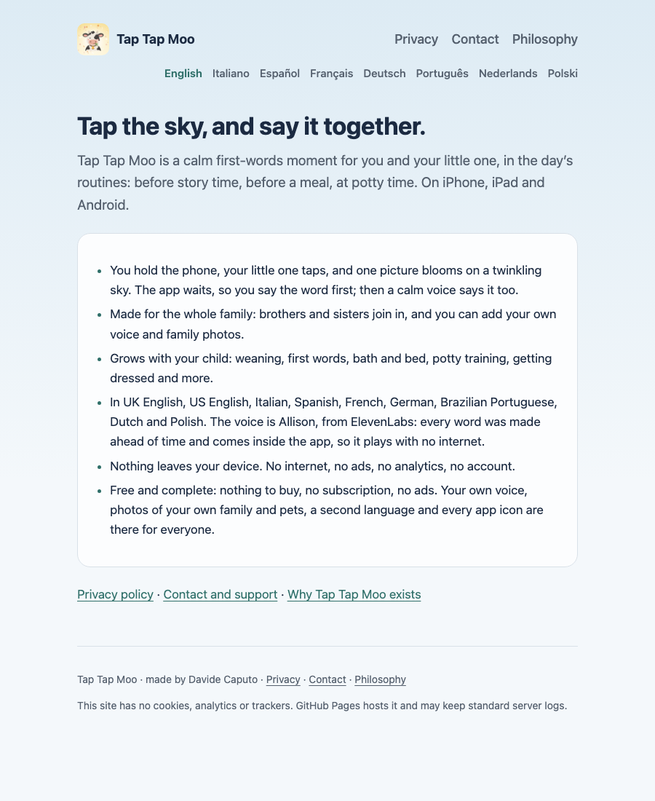

# 🚀 Setup

You need Python 3 and a browser to preview and check the site. Screenshots
need `make screenshots`, which installs Playwright into `.venv-screenshots/`.

## 1. Clone and preview

```bash
git clone https://github.com/CaputoDavide93/tap-tap-moo-site.git
cd tap-tap-moo-site
make serve
```

Open <http://localhost:8000/>. The home page looks like this:

<picture>
  <source media="(prefers-color-scheme: dark)" srcset="assets/screenshots/home-dark.png">
  
</picture>

## 2. Edit a page

Every page is one `index.html` that links `assets/site.css`. Edit the same page
in each language folder: `it/`, `es/`, `fr/`, `de/`, `pt/`, `nl/`, `pl/` and the
root for English. Do not change a page's folder name: the app and the store
listings link to it.

The privacy pages must stay true to the app's own privacy document. If the
meaning of a statement changes, change the app's document first, then every
language here, and update the "Effective" date.

## 3. Check

```bash
make check
```

It fails when a page is missing in a language, a local link or image is
broken, a page contains a script, form or iframe, or an address other than the
support address appears in a `mailto:` link.

## 4. Open a pull request

GitHub Pages serves the `main` branch root, so the merge is the release. Check
the live page afterwards at
`https://caputodavide93.github.io/tap-tap-moo-site/`.

## Add a language

1. Copy a language folder, for example `it/`, to the new code and translate all
   four pages.
2. Add the language's link to the language row of **every** page in every
   folder, with its `hreflang` and `lang` attributes.
3. Add the code to `LANGS` in `tools/check_site.py`.
4. Run `make check`.

## Retake the images

```bash
make screenshots   # docs/assets/screenshots/
make social        # docs/assets/social-preview.png
make diagram       # docs/assets/architecture-*.svg
```
